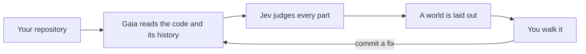

# gaia

## Wander your codebase.

Gaia turns a codebase into a world you walk through. Folders become lands,
and files and functions stand on them as trees, houses and towers, the
biggest for the code that matters most. Healthy code grows lush and whole;
tangled, failing code withers into ruin. Fix it and commit, and you watch the
land around it come back to life.

**Everything runs on your Mac. Gaia reads your code locally and asks Jev, an
AI model, what each part should become and how healthy it is.**

<!-- film: drag gaia-film-readme.mp4 here -->


## Get started

Gaia needs macOS, Node 26, pnpm 10, Rust from rustup, and an
[OpenRouter key](docs/connect-jev.md) for Jev.

```sh
pnpm install
security add-generic-password -s gaia-openrouter -a openrouter -w   # paste your OpenRouter key
GAIA_JEV=live pnpm dev
```

Gaia opens on a map table. Choose a folder on your computer or a public
repository on GitHub, and walk in: click the ground to walk there, and drag
to look around. The first visit is judged in about a minute, for a few cents.

No key yet? Walk a world that comes already judged:

```sh
GAIA_PROJECT=showcase pnpm dev
```

## How it works



Gaia's engine reads your code into a graph of folders, files, functions and
the links between them. Jev reads each part and judges how much it matters,
how well it is written, and what it should stand as in the world. Gaia lays
out the land from the code and stands each part on it, its health shown in
every leaf, roof and field. Jev's answers are kept, so reopening a world only
asks about what changed, and a commit heals an open world in place.

## Documentation

- [Connecting Jev](docs/connect-jev.md) covers the key, the cost and spend limits.
- [Architecture](docs/architecture.md) shows how the engine, the world service and the renderer fit together.
- [Design system](docs/design-system.md) describes how the world looks and why.
- [The showcase](docs/showcase.md) and [the proving ground](docs/proving-ground.md) are the two made-up codebases Gaia is filmed and tested in.
