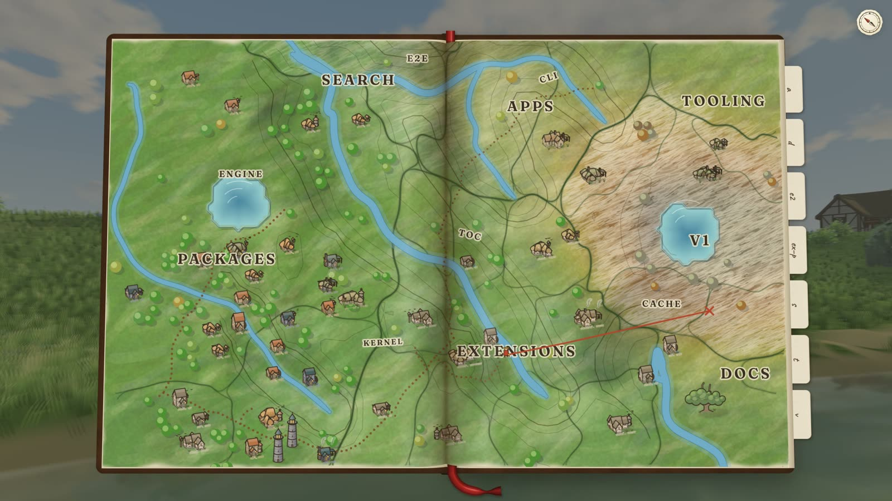
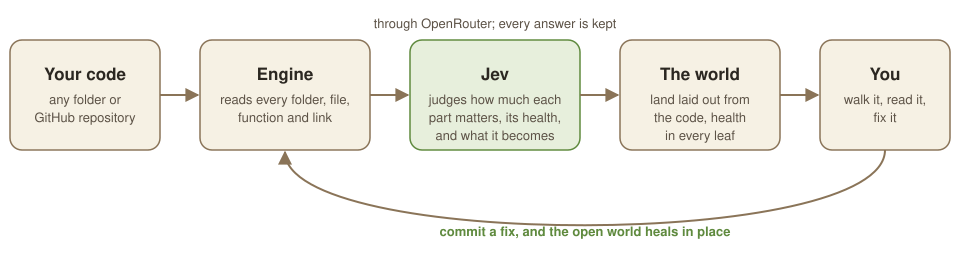

# gaia

## Wander your codebase.

Gaia turns a codebase into a world you walk through. Folders become lands,
and files and functions stand on them as generated entities based on their
determined quality and importance.

https://github.com/user-attachments/assets/2a6665b9-835b-4689-a651-32035e56789e

## Get started

You need Node 26, pnpm 10, Rust from rustup, and an
[OpenRouter key](docs/connect-jev.md) for Jev, the AI model that judges your
code. Gaia reads the key from the macOS Keychain, so judging your own code
needs a Mac for now (linux/windows will be supported soon along with other keys).

```sh
pnpm install
security add-generic-password -s gaia-openrouter -a openrouter -w   # paste your OpenRouter key
GAIA_JEV=live pnpm dev
```

Choose a folder on your computer or a public repository on GitHub, and walk in! 
It takes a minute or two to generate your world. 

For a 100k LOC codebase, this will take only twenty to fifty cents. So walking
around a reasonably sized 10-20k LOC personal project should under 10 cents even
as you update the code.

No key yet? Walk the showcase world to get a feel for gaia!

```sh
GAIA_PROJECT=showcase pnpm dev
```

## Walk around

Tap anything to open the journal at its page: its code, how healthy it is,
and a painting of it. Press M for the journal's map of the whole land, and
tap anywhere on it to travel there.

<p>
  
  
</p>

## How it works



Gaia's engine reads your code into a graph of folders, files, functions and
the links between them and determines the layout of your world. Jev is sent 
the source code as state, along with a series of questions in order to determine
the quality and importance of different parts of your code. Then, Jev also 
determines what objects the entities in your codebase will become. Everything
is procedurally generated, so there are genuinely many billions of unique buildings
and other objects that Jev can put in your world.

From there, your world stays as is until you edit the code (and commit it). If your
change doesn't modify the graph (e.g. you just change the body of a function), the
world will update in realtime. Otherwise you currently need to reload the game. 
Currently, the engine doesn't do a great job at keeping your world salient through 
these changes, but my long term goal is to really make the changes to the world
evocative to the changes in your code.


## Documentation

- [Connecting Jev](docs/connect-jev.md) covers the key, the cost and spend limits.
- [Architecture](docs/architecture.md) shows how the engine, the world service and the renderer fit together.
- [Design system](docs/design-system.md) describes how the world looks and why.
- [The showcase](docs/showcase.md) and [the proving ground](docs/proving-ground.md) are the two made-up codebases Gaia is filmed and tested in.
