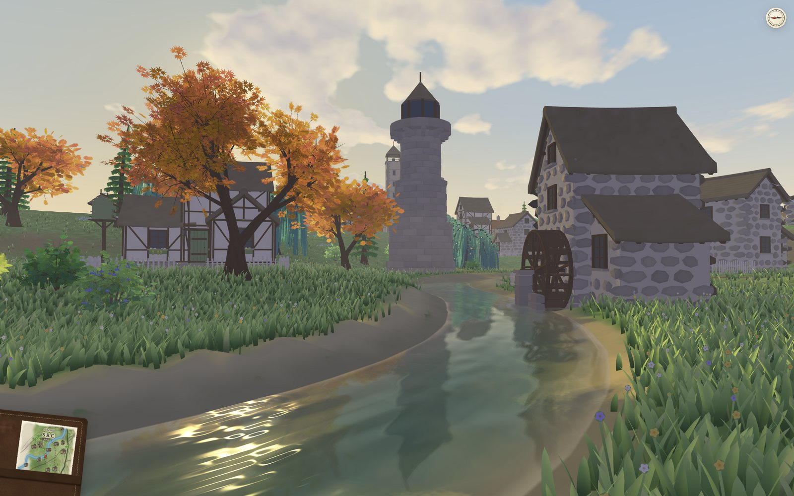
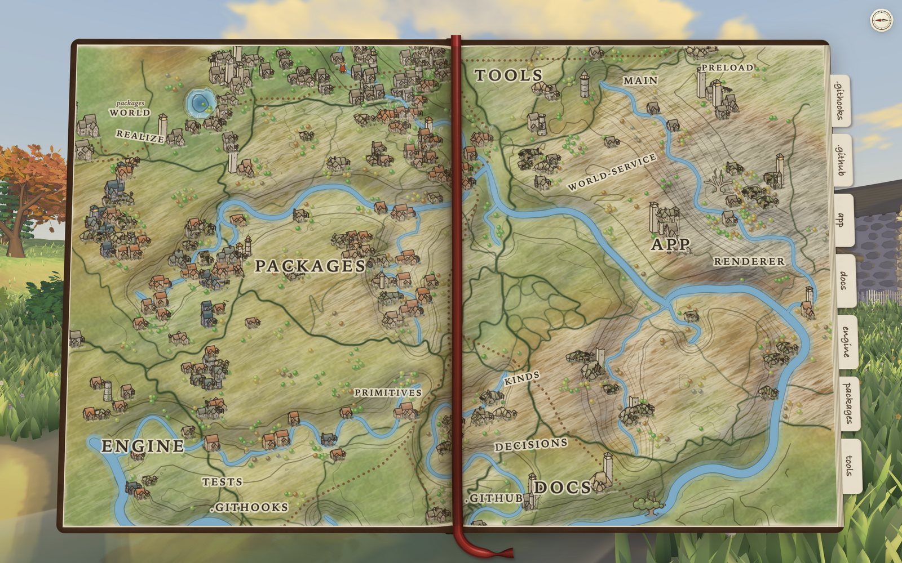

# gaia

**Wander your codebase.** Gaia turns your code into a living world you can walk through. Healthy code grows lush, neglected code falls to ruin, and when you fix it, you watch it heal.

<!-- film: drag gaia-film-readme.mp4 here -->



- **Walk your code.** Folders become lands, files and functions stand as trees, houses and towers, and the parts that lean on each other are joined by trails.
- **See its health at a glance.** Every tree, roof and field shows how well the code it stands for is written.
- **Fix it, watch it heal.** Commit a change while the world is open and the land around that code comes back to life.
- **Read it in the journal.** Tap anything to open its page: its code, how it's judged, and a painting of it.



## Get started

Gaia runs on macOS with Node 26, pnpm 10 and Rust. It uses an [OpenRouter key](docs/connect-jev.md) to judge your code.

```sh
pnpm install
security add-generic-password -s gaia-openrouter -a openrouter -w   # paste your OpenRouter key
GAIA_JEV=live pnpm dev
```

Choose a folder or a GitHub repository, and walk. Click the ground to walk there, drag to look around, and press M for the journal.

No key yet? `GAIA_PROJECT=showcase pnpm dev` opens a made-up codebase whose world is already judged.

Curious how it works? See [the architecture](docs/architecture.md).
