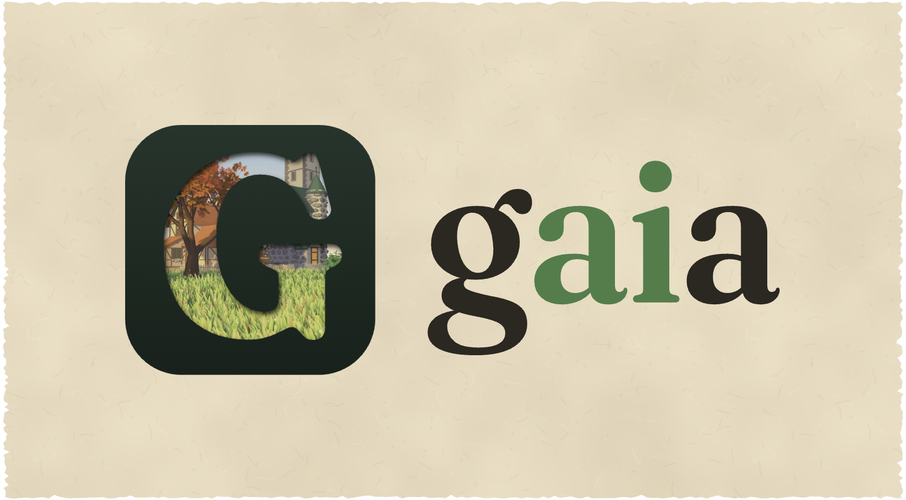
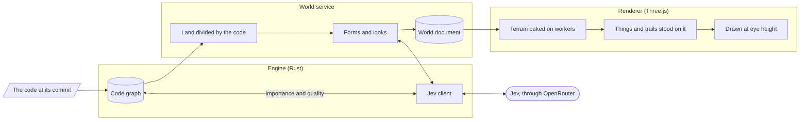

<h1></h1>

**Gaia turns a codebase into a world you walk through at eye height.**

<!-- film: drag gaia-film-readme.mp4 here -->

Each folder is an area of land, and a large folder gets a landscape of its
own. Each file has a patch of ground, and its functions, classes and types
stand on that patch. Every package, file and definition stands as one
thing: flowers, a stone, a bush, a tree, a building or a landmark. Trails
join packages that depend on each other.

Jev, a decision model reached through OpenRouter, reads the code and judges
how much each part matters and how well it is made. The more a part
matters, the larger the forms it can take, and Jev picks one of them. Jev
also picks each landscape and which dependencies become trails. How well a
part is made is its health, and the world shows it everywhere: healthy code
stands green and whole, and poor code withers until its houses fall to
ruin. While you walk, Gaia checks the folder for new commits, and after
each one the health of what changed eases to its new value.


## Running Gaia

Gaia runs on macOS. You need Node 26, pnpm 10, a stable Rust toolchain from
rustup, and an OpenRouter key.

```sh
pnpm install
security add-generic-password -s gaia-openrouter -a openrouter -w   # asks for your OpenRouter key
GAIA_JEV=live pnpm dev
```

`pnpm dev` builds the engine and opens Gaia on a map table, where you choose
a folder on your computer, a world you walked before, or the address of a
public repository on GitHub. `GAIA_PROJECT=/path/to/repo` opens a folder's
world directly.

The first time a codebase opens, Jev judges it in about a minute: this
repository took 322 requests and about two cents. Gaia keeps every answer,
so reopening a world asks only about what changed. Without `GAIA_JEV=live`,
Gaia asks Jev nothing, and a world opens only if every answer it needs is
kept. [Connecting Jev](docs/connect-jev.md) covers the key, the cost and
spend limits.

Click or tap the ground to walk there, and drag to look around. W or ↑
walks ahead, A and D or ← and → turn, S or ↓ walks back, and Shift hurries.

### Without a key

Two made-up codebases open without Jev, because the repository carries
their judgments:

```sh
GAIA_PROJECT=showcase pnpm dev   # the world Gaia's film walks through
GAIA_PROJECT=proving pnpm dev    # every feature a world can show, from thriving to ruin
```

The lab is Gaia's page as one offline file, with no engine behind it:

```sh
pnpm lab:html gaia.html   # this repository's world, from Jev's kept answers
pnpm lab:serve            # the same page on this Mac's Tailscale address, port 5180
```

Add `?world=showcase` or `?world=proving` to the page's address to open the
others.

## The journal


The closed journal at the lower left and a compass at the top right are the
only things on screen besides the world. Tap anything that stands for code
to open the journal at its page, with a painting of it and Jev's scores for
its quality and importance; a file's or a definition's page shows its code.
Press M, or tap the journal, to open it at its map, where each folder is an
area washed in its code's health, from green through gold and russet to
ash. Tap a spot on the map to mark it with a cross, and tap the cross to
travel there.

## How it works



The Rust engine reads the code at its checked-out commit into a graph of
folders, files and definitions, with their imports, calls and git history,
and asks Jev how much each part matters and how well it is made. The world
service divides the land among folders and files by how much code each
holds, then asks Jev what each part stands as and how each land, building
and trail looks. The renderer bakes the terrain on worker threads, stands
everything on it, and draws it. Electron's main process starts the engine
and the world service and opens the window.

Every request to Jev goes through the engine, which alone reads the key,
and Jev answers each question by picking from a closed set of options.
Health is Jev's judgment of the code: Gaia does not run a project's tests,
compiler or linter.

## Docs

- [Architecture](docs/architecture.md): the data, the processes, the
  packages and how a world is made from code.
- [Design system](docs/design-system.md): how everything looks and moves.
- [Decisions](docs/decisions/README.md): what the reviewer settled, and why.
- [AGENTS.md](AGENTS.md): the rules, how to run and check Gaia, and the
  contracts between its parts.

`pnpm check` runs the type checker, the lint rules and the tests, and
`cargo test` and `cargo clippy` cover the engine. CI runs all of them on
every push and pull request. `pnpm readme-shots` retakes the pictures above,
and `pnpm brand --readme docs/images/mark.png` repaints the mark.
