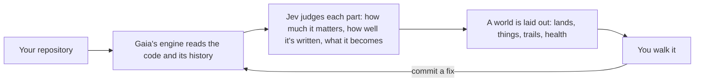

# gaia

**Wander your codebase.** Gaia turns your code into a living world you can walk through. Healthy code grows lush, neglected code falls to ruin, and when you fix it, you watch it heal.

<!-- film: drag gaia-film-readme.mp4 here -->


- **Your code, as a place.** Folders become lands. Files and functions stand as trees, houses and towers, sized by how much they matter, and the parts that lean on each other are joined by trails.
- **Health you can see.** Clean code grows green and whole. Tangled, failing code withers into ruin, so you can spot the rot from across the valley.
- **Fix it, watch it heal.** Commit while the world is open, and the land around the code you fixed comes back to life.
- **Judged by an AI, not a linter.** Jev reads your code and decides what every part should become and how healthy it is. No two codebases grow the same world.

## How it works



Jev is reached through OpenRouter. Its answers are kept, so reopening a world only asks about what changed. More in [the architecture](docs/architecture.md).

## Get started

Gaia runs on macOS with Node 26, pnpm 10 and Rust, and an [OpenRouter key](docs/connect-jev.md).

```sh
pnpm install
security add-generic-password -s gaia-openrouter -a openrouter -w   # paste your OpenRouter key
GAIA_JEV=live pnpm dev
```

Choose a folder or a GitHub repository, and walk. Click the ground to walk there and drag to look around.

No key yet? `GAIA_PROJECT=showcase pnpm dev` opens a made-up codebase whose world is already judged.
