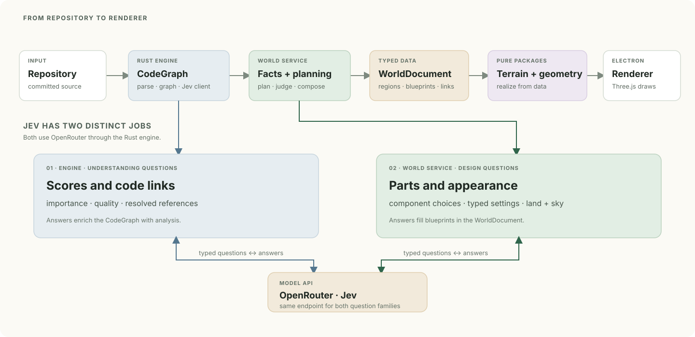
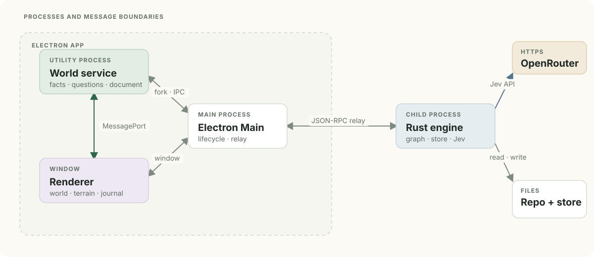
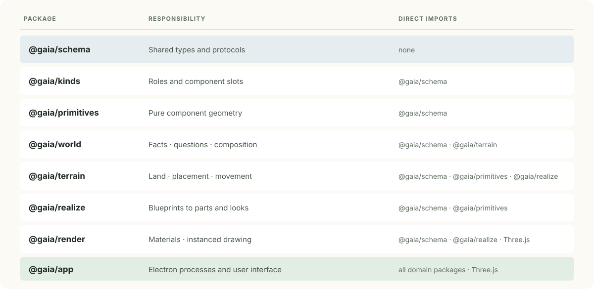
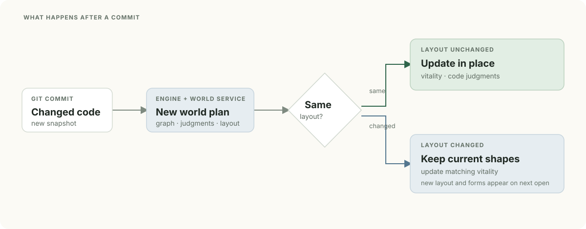

# Architecture

Gaia turns a repository snapshot into a typed `WorldDocument`, then realizes
that document into terrain and geometry. Jev has two separate jobs along the
way: judge importance and quality, and choose the world's appearance.

## Data flow

The Rust engine builds the `CodeGraph` and owns the only OpenRouter client. The
world service derives facts and plans world design questions. Both Jev paths
use typed requests and reuse answers saved by request hash. The renderer gets
the finished `WorldDocument`; geometry stays inside the pure world packages.

### The two Jev paths

| | Code understanding | World design |
| --- | --- | --- |
| Planned by | Rust engine | TypeScript world service |
| Questions | How important is each part? How healthy is it? Which code links resolve? | Which eligible parts and settings fit this code, region or dependency? |
| Results | Importance, quality, selected code spans and resolved graph links | Choices of kinds, primitives and typed settings for the land, sky and things |
| Used by | Vitality, code facts and world layout | Blueprints in the `WorldDocument` |

Code understanding is defined in `engine/src/jev/` and
`engine/vocab/understanding.toml`. World design uses the kinds and primitive
schemas in `packages/kinds` and `packages/primitives`, with planning in
`packages/world`. Jev can choose only the options those schemas offer. Code
supplies coordinates and measurements; pure packages build the geometry.

## Code understanding

The engine reads a committed Git tree, or the working directory when no
committed tree exists. Tree-sitter queries build a graph of directories, files,
definitions and blocks. Containment and code links describe how they connect.
Language grammars and resolution rules are configured in
[`engine/languages.toml`](../engine/languages.toml) and
[`engine/queries/`](../engine/queries).

The link pass resolves uncertain references from candidate choices. The
understanding pass then judges folders from parent to child, and files after
their folders. Requests carry the project's description and surrounding code.
Large files are partitioned at definition boundaries to fit requests without
trimming away source.

Importance and quality are separate. Importance controls which forms and sizes
are offered to an item. Quality becomes its vitality. Definitions are assessed
for correctness, readability, simplicity, cohesion, coupling, explicitness,
consistency, testability, robustness and efficiency. Container quality combines
its own criteria with its contents. The levels, weights, excluded data roles,
and key/weak block selections are defined in
[`understanding.toml`](../engine/vocab/understanding.toml).

The engine stores raw responses by request hash and tracks held judgments by
code lineage. A repeated request can reuse its response; matching lineage helps
keep judgments stable through edits. These are separate mechanisms in
[`runner.rs`](../engine/src/jev/runner.rs) and
[`hold.rs`](../engine/src/jev/hold.rs).

## Runtime boundaries

Electron Main starts the world service, renderer and engine. It relays engine
calls over newline-delimited JSON-RPC. The service sends the renderer its
document and progress over a `MessagePort`. These boundaries are declared in
`app/world-service/protocol.ts` and `packages/schema/src/engine.ts`.

Sound runs only in the renderer, in `app/renderer/sound/`. Each frame the world
reports what reaches the person (`WorldHandle.earshot()`), and the sound module
turns that into Web Audio levels; the pure packages make no sound. A recording
is decoded only while it may be heard, the music a 4-bar chunk at a time just
before it plays, and the same graph renders a recorded walk offline.

## Packages

The diagram lists each package's role and direct imports.

`schema` defines the contracts shared across packages. `kinds` name the roles
and subjects in a world; `primitives` implement the parts that fill those
roles. A blueprint records a kind, its chosen primitives and their typed
settings. `world` plans and composes blueprints; `terrain` lays out and stands
the world; `realize` turns blueprints into parts; `render` draws them.

The world, terrain, kinds, primitives and realize packages are pure: no DOM,
clock, filesystem, `Math.random` or Three.js. Their import and purity rules are
enforced in `eslint.config.js`. The app connects those packages to Electron,
workers and the renderer.

## Composing a component

A kind declares slots by role, such as a building's footprint, walls, roof and
openings. A primitive implements a role, declares closed parameters and builds
pure geometry. Its requirements can restrict where it is offered, such as a
waterwheel's need for running water.

The planner first asks which primitives fill the slots, then asks their
settings in stages. Later stages see earlier choices. The resulting blueprint
contains identifiers and typed values; it contains no model-generated code,
shaders or coordinates. This keeps composition flexible while geometry and
placement remain deterministic.

A primitive writes channels for health and motion as it builds. Shared shaders
apply vitality and time to those channels, so a change in health can alter
foliage or ruin without rebuilding geometry. The
[design guide](design-system.md) describes those visual rules.

## Opening a world

1. The engine reads a snapshot and builds a graph of directories, files,
   definitions and code links. In a Git repository with commits, the snapshot
   is the committed tree; uncommitted edits do not enter the world. Without a
   committed tree, Gaia reads the disk while respecting ignore rules.
2. The engine asks code-understanding questions for importance, quality and
   code links. The world service derives facts from the graph and asks its
   separate design questions; the final design uses the judged graph.
3. The world service composes typed answers into a `WorldDocument` and lays
   out its regions, things and paths.
4. Pure packages turn the document into terrain and geometry. The renderer
   builds and draws the result.

Jev's answers are stored per project by request hash, so an unchanged request
can be reused on the next opening. Gaia stores the answers, not the complete
`WorldDocument`.

## Changes to an open world

When a commit leaves the layout unchanged, the open world advances to the new
commit and updates its code judgments and vitality. If the layout would move,
Gaia keeps the current layout and forms, updates vitality for matching things,
and shows the new layout and forms on the next open. This behavior is handled
by `healWorld` in `app/world-service/open-world.ts`.

## Where to look next

- [Development](development.md): commands, fixtures and verification.
- [Connecting Jev](connect-jev.md): key, estimates and spend limits.
- [Design system](design-system.md): how components and vitality look.
- [`packages/schema`](../packages/schema/src): engine, world and Jev contracts.
- [`app/world-service/open-world.ts`](../app/world-service/open-world.ts): opening and updating a world.
- [`engine/src/jev`](../engine/src/jev): code understanding and the OpenRouter client.
