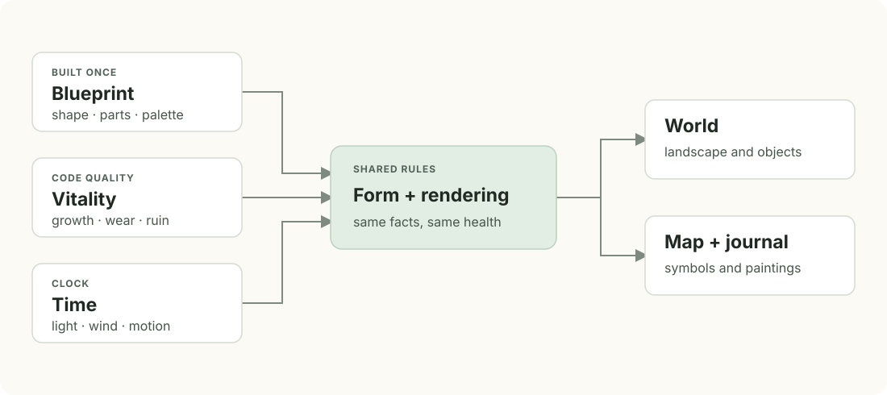

# World design

Gaia should feel like a landscape that happens to represent code. Its visual
reference is the painterly light, readable silhouettes and natural forms of
Breath of the Wild. Code health belongs throughout that landscape, and details
about the code belong on paper the person chooses to open.

## Shared visual rules

- Use soft bands of light, tinted shadows and atmospheric distance. Shadows
  retain color at night; nearby lantern light restores warm surface colors.
- Give each component a clear silhouette and physical support. Branches carry
  leaves, walls carry roofs, and fallen pieces settle against their supports
  or the ground.
- Keep effects subtle. Motion, glow and saturation should support the scene
  without competing with the code's visible health.
- Keep detail stable while walking. Streaming, culling, shadow updates and
  transitions to distant forms must not cause visible changes of shape.
- Preserve immersion. World objects do not gain hover outlines, click rings,
  floating labels or status text. The journal, map and compass provide the UI.

## Color and light

A world chooses shared light, sky and wind. Each region chooses its landform,
ground cover, air, accents and native palette families. A component uses one
family from those available in its region, so buildings and plants belong
together. The palette's swatches cover foliage, bark, stone and building parts;
individual components do not invent colors.

Healthy palettes vary, but all decline toward dry, muted colors. Hue variation
within healthy foliage must not alter the meaning of decline. The map uses a
consistent green-to-gold-to-russet-to-ash health scale across worlds.

The hour follows the local clock. Daylight interpolates between lighting keys;
Jev chooses the character of the light rather than the time. At night,
moonlight keeps the landscape readable, windows and lanterns stay warm, and
emissive effects remain restrained. Sky and aerial perspective use the same
color model so distant land meets the horizon without a visible seam.

| Source | Owns |
| --- | --- |
| [`primitives/src/palettes.ts`](../packages/primitives/src/palettes.ts) | Palette families and swatches |
| [`realize/src/day.ts`](../packages/realize/src/day.ts) | Time and lighting interpolation |
| [`render/src/light.ts`](../packages/render/src/light.ts) | Shared lighting, atmosphere and lantern shading |
| [`realize/src/sky.ts`](../packages/realize/src/sky.ts) | Sky reference model |

## Form and composition

Importance controls the sizes a code item can be offered; Jev chooses its
form by character within that set. A short but important function can be a
large tree. Every code tree, bush, stone, flower group, building or landmark
represents an entity, file or definition. Ambient ground cover fills the
spaces between them; decorative trees do not stand for invented code.

Kinds declare the roles to fill. A building, for example, combines a footprint,
walls, roof, openings, dressing and a feature. The same roles can be filled by
different primitives. Later design questions see earlier choices, so windows
fit their walls and features fit their site. Jev selects closed options; code
calculates geometry and positions.

### Foliage and bark

Build full canopies from overlapping sprays and layered leaves on branches.
Never hide a dark ball or body inside a crown, bush or fir frond. Gaps should
reveal twigs, deeper foliage and sky. A crown is as full on a large frame as
on a small one: a leaf mound on a tree's frame grows as many clusters for its
size as a bush's, and needles hang as a fir's fronds along whorled limbs but
gather in a pine's tufts at the tips of a broadleaf's forking limbs.

Leaf cuts, bark and canopy lighting are shared across components. Leaves read
as individual shapes close up and coherent masses farther away. Bark faces
outward; branch joins remain continuous; root flares meet the ground instead
of ending above it or in sharp spikes.

### Buildings and landmarks

Building massing changes the whole silhouette: wings, ranges, storeys, roofs
and attachments must compose without exposed interior walls or roof gaps.
Openings remain accessible. Foundations and terrain pads seat buildings in
the land, and floors cover the ground inside them.

A feature belongs to a physically suitable site. A waterwheel requires running
water, sits at its own stream's bank, and reaches the water while its house
stays dry. Landmarks use prominent, walkable ground and silhouettes that remain
recognizable through haze.

Two landmarks Jev answers alike never stand as twins. Each landmark's seed
picks the proportions a person notices within what its words allow: a rotunda's
span, its columns' height, girth and spacing, its dome's rise and its steps'
depth; a tower's girth, taper, stages and walkways; a mill's body, stage and
sails; an arch's opening; how far apart standing stones stand; every limb of a
great tree. A word's look never crosses into its neighbour's: a seeded shallow
dome stays lower than any high one, and six columns stay wider apart than any
eight. The seed also chooses the side a landmark's weather comes from, where
its columns topple first, its tower breaks lowest, its stones lean away and its
mill's cap lists. Each primitive's bands are in its shape table, such as
`ROTUNDA_SHAPE` in
[`rotunda.ts`](../packages/primitives/src/geometry/landmark/rotunda.ts).

Ruin follows structural support. Coverings fail with or before their frames;
upper masonry cannot outlast the blocks supporting it. Detached pieces collapse
onto a support or the ground. Ivy grows on remaining walls rather than across
holes. Decline should remain legible from a distance.

| Source | Owns |
| --- | --- |
| [`terrain/looks.ts`](../app/renderer/terrain/looks.ts) | Available forms, importance ranges and water choices |
| [`packages/kinds/src`](../packages/kinds/src) | Component roles and stages of composition |
| [`packages/primitives/src`](../packages/primitives/src) | Geometry, closed parameters and palette selection |
| [`terrain/stand.ts`](../app/renderer/terrain/stand.ts) | Placement in the world |

## Wind, gravity and vitality

Primitives supply the channels that shared rendering uses for motion and
health. Geometry is built independently of the current vitality: a live health
update changes rendering inputs rather than reconstructing the component.

One wind field reaches grass, flowers, bushes, trees and smoke. The field
controls direction and gusts; each plant's joints and stiffness determine its
response. A hanging strand bends about its support rather than stretching,
and a gust should never separate leaves from their stems.

Health affects the whole place. Leaves thin and sag, bark greys, buildings
weather and collapse, grass dries and reveals earth, water clouds, and trails
to failing code grow over. The map and journal show the same judgments. Ground
and water blend health across boundaries so neighboring patches do not meet
at an abrupt seam.

| Source | Owns |
| --- | --- |
| [`schema/src/ports.ts`](../packages/schema/src/ports.ts) | Geometry and vitality channels |
| [`realize/src/sway.ts`](../packages/realize/src/sway.ts) | CPU motion reference and joint behavior |
| [`realize/src/wind-field.ts`](../packages/realize/src/wind-field.ts) | Wind field and gusts |
| [`render/src/plant.ts`](../packages/render/src/plant.ts) | Shared component shading and decline |
| [`terrain/src/vitality.ts`](../packages/terrain/src/vitality.ts) | Ground health and decline |
| [`terrain/vitality.ts`](../app/renderer/terrain/vitality.ts) | Shared ground, grass and water shader rules |

## Terrain, walking and travel

Areas form a continuous landscape. Landforms, covers and air blend across
region boundaries. Rivers follow the terrain, cross area boundaries and join
one another at the surface of the river they meet. Each runs on until it meets
another river, a pond or the land's edge; one that crosses a hollow cuts
through its rim rather than ending in it. Ponds remain enclosed: a river that
ends in a pond meets it at the pond's surface and never cuts below its rim.
Trail networks share treads and junctions rather than duplicating paths, and
cross water with bridges or stepping stones. Their coverage budgets preserve
open ground.

Walking follows the ground, intact bridge decks and the walkable steps and
floors of landmarks, such as a rotunda's. Solids stop or deflect a
walk; water permits wading and swimming. A broken bridge can stop a walk and
force a trip to ford beside it. Grass and understory clear the footprints of
structures, landmarks, rocks and paths. Under every bush, on the land or in
the wild, the grass gives way over about half the bush's outline at the
ground (`SHRUB_CLEARS` in
[`understory.ts`](../app/renderer/terrain/understory.ts)), as grass grows
thin under a real shrub's canopy. The grass round the bush's edge stays tall.
Round a drift of mushrooms, which stand
at their natural size, the grass grows only as short turf with a ragged edge,
so they show.

The camera stays level: no head bob, sway or roll. Forward and backward keys
walk; side keys turn at a constant rate, with a small nudge on a tap. Backward
walking keeps the view facing ahead. Dragging looks around. These constraints
limit unexpected camera motion and avoid turns that accelerate.

Map travel follows a route, taking a direct path when trails would make a long
detour. It goes around deep water and solids. While the journal stays open over
a trip, travel can accelerate behind the paper; the book closes after the
destination is ready. A place without a route uses a covered jump.

Movement constants live in `GAIT`, `STEER` and `TRAVEL` in
[`gait.ts`](../packages/terrain/src/gait.ts),
[`steer.ts`](../packages/terrain/src/steer.ts) and
[`travel.ts`](../packages/terrain/src/travel.ts). Keep their values in code so
changes do not leave a second specification behind.

## Sound

The world is heard as it is seen. Field recordings (wind in the grass, the
brook, waterwheels, birds, crickets, footsteps and the journal's paper) play
under music derived from the announcement film's storybook score. Nothing is
synthesized. Sound follows the rule for effects: subtle, never loud, and
nothing that draws attention to itself.

- Levels follow the film's Hush mix: the music at −21 LUFS and the world
  about 10 dB under it. No sound rises more than 6 dB over its level, however
  near or strong.
- What reaches the person comes from where they stand: the gust there, the
  nearest stream and waterwheel by distance and side, the hour's dark, the
  crowns overhead and how far the land around has failed. Birds sing by day
  over thriving land and fall silent where it fails; failing land dries the
  wind and the footsteps; a stopped waterwheel makes no sound.
- The music never stops. Strings and harp hold under everything, the theme
  plays two times round in three, a night colour joins at dusk, and the
  harmony turns minor over failing land.
- The help slip sets the music and the world apart, each from silent to as
  mixed, and the game remembers both. A window no one can see makes no sound.

| Source | Owns |
| --- | --- |
| [`sound/hearing.ts`](../app/renderer/sound/hearing.ts) | What is heard where, as levels, sides and tone |
| [`sound/music.ts`](../app/renderer/sound/music.ts) | How the score plays |
| [`sound/levels.ts`](../app/renderer/sound/levels.ts) | The slip's music and world levels |
| [`sound/assets/CREDITS.md`](../app/renderer/sound/assets/CREDITS.md) | Each recording's source and licence |

## Journal and interaction

Clicking or tapping land walks there. Selecting a code object opens its
journal page at the person's current position. The journal opens only when
requested. Its closed cover carries the minimap at the lower left; the compass
at the upper right opens the help slip, which also holds the sound's levels.

The journal presents a code item's name, quality, importance, code and a
painting from the actual world. Scores are percentages. Folder and file leads
use their most important code; the appendix carries key and weak block marks.
Paths, references and folds lead to the corresponding pages or source.

Pages turn as paper, and distant pages are reached by a riffle. A destination
page appears only when its text and painting are ready. Tabs and the ribbon
remain attached to the book through turns and opening animations. Paintings
keep their colors under the pointer.

`M` opens the journal map and `/` opens its finder. A map click marks a place;
a second click on that mark starts travel. The map remains open over the trip
and follows the traveller. A painting can also send the person to its subject.

| Source | Owns |
| --- | --- |
| [`immersive/view.ts`](../app/renderer/immersive/view.ts) | World selection, journal integration and help |
| [`journal/book.ts`](../app/renderer/journal/book.ts) | Opening, page turns, tabs and ribbon |
| [`journal/pages.ts`](../app/renderer/journal/pages.ts) | Page structure and navigation |
| [`journal/painter.ts`](../app/renderer/journal/painter.ts) | Brushwork from world captures |

## The field sheet

The map, minimap, journal and waiting screen share warm paper, brown ink and
watercolor. Survey capitals identify places; handwritten notes identify the
traveller's marks. Vermilion marks the traveller and travel route. Paper warms
and dims under lantern light at night.

The maps use real terrain heights and river courses. Building, landmark, tree,
bush, stone and flower symbols come from their composed blueprints, with the
same wear as the world: a fir draws as tiers up its trunk and a failing one as
bare whorls. Trees keep a legible size on the whole sheet; stones, bushes and
flowers stand at their size on the land, so they come in as the map comes
close.
Color means health. Outside the code's land, unwashed paper and survey ink
represent the wild, which has no code health to score.

The minimap turns with the person; larger maps face north. Names use a common
layout that keeps them clear of other names and symbols. The waiting screen
uses that same layout and painter to show completed analysis and design work.
It never paints fabricated progress or provisional judgments as final health.

[`map-styles.ts`](../app/renderer/immersive/map-styles.ts) defines shared paper
and map styles. [`marks.ts`](../app/renderer/immersive/marks.ts) draws composed
buildings and landmarks and
[`plant-marks.ts`](../app/renderer/immersive/plant-marks.ts) composed plants and
stones; [`map-names.ts`](../app/renderer/immersive/map-names.ts) places names;
[`wait/map-wait.ts`](../app/renderer/wait/map-wait.ts) draws progress.

## Start page and Gaia's mark

The start page is a physical map table under the world's light. Cards show
saved paintings of previously visited worlds, with a commit tally when their
code has changed. Choosing a card raises it into the waiting sheet, where the
new map is drawn. The table releases its rendering resources once the world
opens.

Gaia's mark combines a G cut through a green page with the lowercase name, its
"ai" in green. The journal uses the same title face without turning arbitrary
letters in project names green. Brand construction lives in
[`brand/paint.ts`](../app/renderer/brand/paint.ts) and
[`brand/logo.ts`](../app/renderer/brand/logo.ts).

## Detail at a distance

A distant form is baked from the same component and shaders as the full one.
The transition preserves coverage and silhouette, then dissolves fine detail
under the far form. While both draw, the far form stands just in front of its
full form, and the full form thins sample by sample through its coverage, never
a whole pixel at a time, so neither shows through the other as a stipple. View,
reflection and shadow passes select appropriate
detail from screen size. Grass narrows smoothly rather than changing height as
the person approaches.

A far form keeps its tree's outline as it shrinks past the size it turns far
at. There its edge is sharpened to match the full form's, and sharpened less
the barer its tree, since a bare tree is mostly twigs finer than a texel that
a sharp edge would cut away (`CARD` in [`far.ts`](../packages/render/src/far.ts)). Smaller, each texel
it reads stands for more of the plant, and a twig, strand or needle finer than
a texel covers only part of one. The far form draws that part as it is, where
a sharpened edge would cut it away, so its outer twigs thin with distance as
the full form's do rather than vanish. The [likeness probe](development.md#visual-verification)
holds each far form to its full form at a half, a quarter and an eighth of the
size it turns far at.

A far form declines as its tree does. Its views hold the plant as it stands
healthy, with how much of each texel it covers at several vitalities down to 0
(`SLICES` in [`far.ts`](../packages/render/src/far.ts)), so a copy covers what
its tree still holds, and a copy of the poorest code only what its tree keeps.
A piece that shows and is gone by vitality 0 keeps its healthy color rather
than darkening. A tired tree's boughs sag about their joints and leave that
healthy outline, so the bake also keeps a coarse field of where each point
moves as its boughs sag all the way (`droopField`). The far form finds where
the point its eye meets came from and reads its views there: its boughs sag as
far as its tree's do at its copy's vitality, and a change of vitality moves
what it reads without baking again.

Do not reduce density abruptly to rescue frame time. Batch and instance shared
geometry, stream ahead of the person, cache far forms, and keep shadow updates
stable in world space. Memory for far forms is a fixed budget: a build whose
far form is not held draws its full form, never a coarser card, and a form
coming in or leaving moves its swap size over many frames rather than
changing a tree at once. The budget holds each form's views at every mip level
a far form reads before it is too small to see, and its droop field
(`farSlotBytes`). Use the [walking and swap probes](development.md#visual-verification)
to check that a performance change preserves the view.
